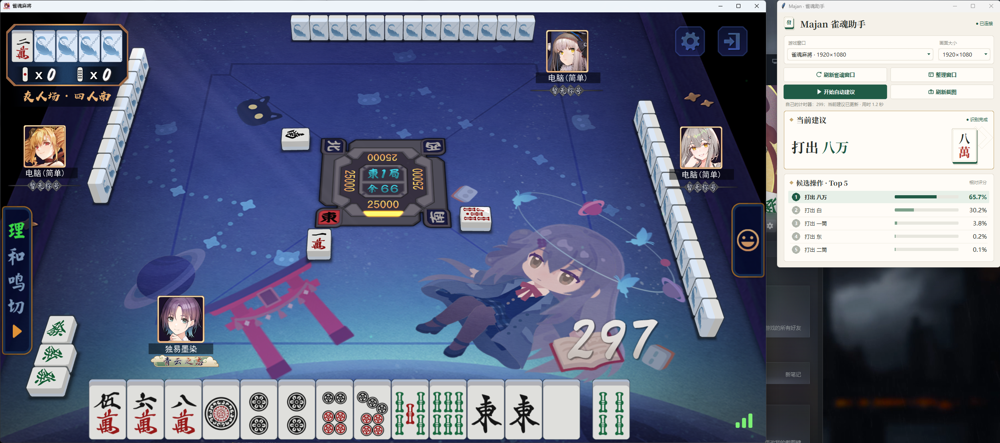
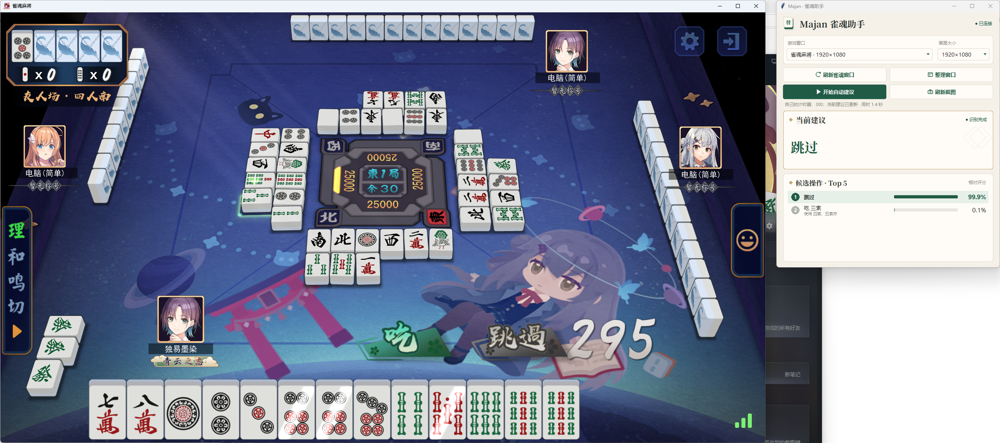
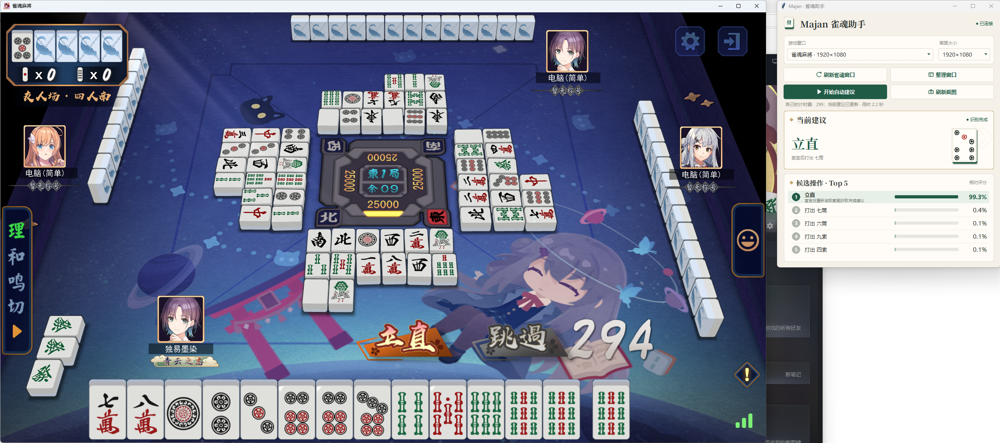
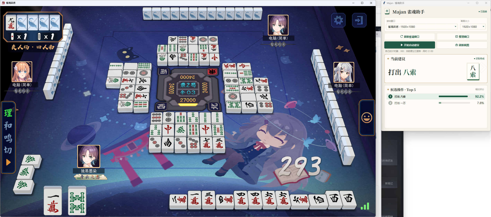
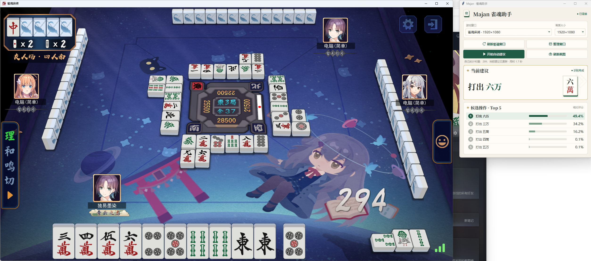

# Majan 雀魂助手

根据雀魂游戏窗口截图识别手牌与公开信息，在独立面板中显示当前行动建议和 Top 5 候选操作。

**[下载 Windows NVIDIA 便携测试版 2](https://github.com/guangjiaohuoqiubumingzhong/majang/releases/tag/v0.1.0-portable-test2)**

## 实机演示

以下为雀魂客户端与助手同时运行的实际截图。

### 弃牌建议

显示推荐打出的牌，以及其他候选操作的相对评分。

### 吃牌响应

遇到可以吃牌的局面时，对比吃牌与跳过等候选操作。

### 立直建议

显示立直建议及宣言后应打出的牌。

### 副露后的弃牌建议

根据副露后的当前牌面显示弃牌建议。

### 别家立直识别

别家立直场景的实机示例：助手完成当前画面识别并给出“打出六万”的建议。

面板中的百分比是候选操作的相对评分，不代表胜率。

## 下载与使用

1. 在 [下载页面](https://github.com/guangjiaohuoqiubumingzhong/majang/releases/tag/v0.1.0-portable-test2) 下载 `.zip.001`、`.zip.002` 和 `Merge-Package.cmd`，放到同一个文件夹。
2. 双击 `Merge-Package.cmd`，等待合并与校验完成，再完整解压生成的 ZIP。
3. 双击 `Majan/Majan.exe`，打开雀魂 Steam 客户端，选择游戏窗口和画面大小，再点击“开始自动建议”。

便携包约 2.55 GB，解压后约 3.8 GB；合并时还需额外约 2.55 GB 空间。需要 Windows x64、兼容 CUDA 12.x 的 NVIDIA 显卡和驱动，无需另装 Python。

## 使用范围

- 当前适配雀魂 Steam 客户端的默认牌面，支持 1366×768、1920×1080 两种画面大小。
- 测试版请先保持游戏窗口可见，后台或遮挡采集仍有兼容限制。
- 对识别不完整的画面会提示核对；建议仅供参考，请自行判断实际操作。

详细用法见 [截图建议说明](docs/screenshot-advice.md)。

## 项目资料

[源码与重建](SOURCE-CONTENTS.md) · [开发记录与技术说明](docs/development-history.md) · [第三方许可](THIRD_PARTY_NOTICES.md)
